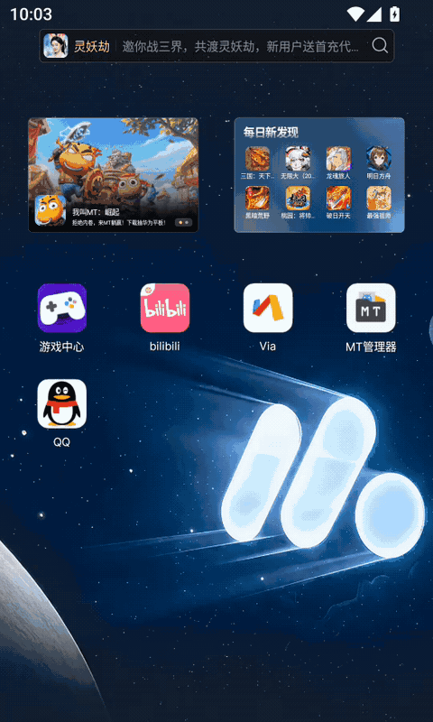

# astrbot_plugin_mumu_vm · 给 AI 一台安卓手机



- **是什么**：一个 AstrBot 插件，让 AI Agent 独占操控一台运行在 MuMu 模拟器里的安卓手机——它自己看屏幕、点按钮、打字，像一个真人一样用手机。
- **能干什么**：Agent 可以开 App、刷视频、截图/连续多帧看动态画面、打字评论、空闲或定时自主玩；收手后继续普通对话，还能把使用记录和操作技巧存进本地记忆做语义检索。
- **怎么装**：把本仓库（或 Release 里的 zip）放进 AstrBot 的 `data/plugins/`，装好 MuMu 模拟器与（可选）ffmpeg；录音需要 `pip install capturekit`，然后在 WebUI 重载插件即可。

适用：Windows + MuMu NX / MuMu 12（`MuMuManager.exe` 可用）+ AstrBot 4.27 ~ 4.29。
[](https://github.com/AwayDAJIBA/astrbot_plugin_mumu_vm/releases)
[](./LICENSE)
[](https://astrbot.app)
更多：[功能一览](#1-功能一览) · [安装](#2-安装) · [更新日志](CHANGELOG.md) · [Release 下载 zip](https://github.com/AwayDAJIBA/astrbot_plugin_mumu_vm/releases)

---


## 1. 功能一览

| 能力 | 说明 |
| --- | --- |
| 🫥 桌面只给 Agent 看 | `MuMuManager control hide_window` 隐藏模拟器窗口，之后全部通过 adb 截图/操作；启动时还会反复确认隐藏，避免窗口弹出来 |
| 📸 单帧截图 | `mumu_phone_screen` 返回 1280px 宽的 PNG（可裁剪/延迟/叠坐标网格），适合看静态页面 |
| 🎞 连续采样多帧 | `mumu_phone_frames` 按 Agent 指定的采样参数（`duration` 时长 / `count` 帧数 / `fps` 每秒帧数 / `every` 每几秒一帧）采样，**一次调用返回多张图**（`mode=frames` 一帧一张图，默认；`mode=sheet` 拼图版自动分页），每帧带 `#序号 时间戳` 标签；帧太多时按 `max_images` 分多张图继续给，不再硬塞进一张拼图 |
| 🎙 媒体辅助（可选） | 主模型没有语音/视频模态时：`mumu_phone_record_start/stop` **后台录屏**→抽帧交给视觉/全模态模型转述画面；`mumu_phone_hear_start/stop` **后台录音**（WASAPI 进程 loopback，**只录 MuMu 进程自己的声音**，不录 Windows 默认扬声器/其它应用）→STT 转写/音频多模态模型描述声音；三者可同时开启；录制期间仍可正常操作手机、截图/多帧采样 |
| 🖱 精确操作 | 点击（支持按文字/UI 编号直接点）、长按、滑动/滚动、按键、中文/emoji 输入（自带 ADBKeyboard，自动安装） |
| 🧭 UI 树 | `mumu_phone_ui` 返回可点击/可输入元素（中心坐标 + flags），比截图找按钮准 |
| 📱 App/系统 | 前台应用、已安装列表、搜索、启动、打开链接、强停、安装/卸载 APK、电量/网络/IP/亮度/音量/旋转/解锁/通知栏/任意 shell |
| ✂️ 玩手机模式精简 | 普通聊天只注入 4 个轻量手机工具；进入手机模式后**只保留 26 个手机工具**（+ 可配置的 `send_message_to_user` 和记忆插件工具），并裁剪对话历史、附加内容与系统提示，保证速度 |
| 🧰 同轮进出手机模式 | **由 Agent 自己判断后调用 `mumu_phone_play` 进入**（默认不再靠聊天关键词自动触发，避免误触）；进入后**当前这一轮**的工具组立即换成完整手机工具；调用 `mumu_phone_exit` 收手后，同一轮回答内自动换回普通工具，可以继续做其它任务，**不会中断本次回答** |
| 🧠 记忆可切换 | iris 兼容开关（`iris_compat_enable`）可一键关闭对 iris 的注入/写入/工具依赖；关闭后改用**插件自带本地记忆**：收手总结与操作技巧自动保存，可用 `mumu_phone_memory` 做**语义检索**（Embedding Provider，缺失时关键词兜底），iris 开着时也额外存一份 |
| 📨 打扰拦截 | 玩手机时来消息：不回复正文，只自动回"正在玩手机"，并把消息入队 + 在后续工具结果/系统提示中通知 Agent，由 Agent 自己决定是否用 `mumu_phone_say` 回复 |
| 🤖 自主玩手机 | 主 Agent 回合结束后可自动转入后台自主模式继续玩；也支持**空闲 N 分钟自动开始**、**指定时间定时开始**、每日次数/时长预算；到点/空闲/Agent 主动都能收手并关掉模拟器 |
| 🧠 连续性 | `mumu_phone_diary` 记录每轮"玩到哪了"，跨轮次/跨回合保持上下文 |
| 🛠 排障 | 插件数据目录 `diag.log` 记录启动、工具调用、关机等关键事件 |

## 2. 安装

1. 把本目录复制到 AstrBot 的 `data/plugins/astrbot_plugin_mumu_vm/`。
2. 在 AstrBot WebUI → 插件管理里重载插件（或重启 AstrBot）。
3. （可选）确认宿主机已安装 MuMu 模拟器；插件会自动探测 `MuMuManager.exe` 与 `adb.exe`：
   - 常见位置：`C:\Program Files\Netease\MuMu\nx_main\MuMuManager.exe`
   - 多开/自定义路径可在插件配置里填 `mumu_manager_path` / `adb_path`
4. （可选但强烈建议）安装 ffmpeg 并在配置里填 `ffmpeg_path`，密集连续采样才走"真·录屏抽帧"（稀疏采样直接连续截图，不依赖 ffmpeg）。
   Pillow / mcp 随 AstrBot 提供，无需额外装。
5. （可选）媒体辅助的**录音**需要进程级音频采集：在 AstrBot 运行环境执行 `pip install capturekit`（纯 Python + numpy）；它用 Windows WASAPI **进程 loopback 只抓 MuMu 进程的声音**，不会录 Windows 默认扬声器/其它应用。不装也可以只用录屏/视觉转述；也可用 `media_audio_backend=ffmpeg` + `media_audio_device` 走一台**专用** dshow 设备。

> 首次进入手机模式会自动开机，冷启动可能需要 1~2 分钟（插件会先同步开机再调模型，避免工具调用超时）。

## 3. 使用方式

### 3.1 让 Agent 用手机（自然语言）

直接对机器人说：

- "去玩手机，帮我打开设置看看现在是什么系统版本"
- "看看手机屏幕上现在显示什么"
- "用手机搜一下 xxx，然后告诉我结果"

是否进入手机模式由 **Agent 自己判断**：普通聊天里会注入 `mumu_phone_play` 等 4 个轻量手机工具，Agent 判断需要操作手机时调用进入。默认**不再用聊天关键词自动进入**（`natural_language_entry=false`，避免误触）。进入后：

- **当前这一轮**的工具组立即切换为完整手机工具，可以直接截图/点击/操作手机，不需要等下一轮；
- 操作完调用 `mumu_phone_exit` 收手，**同一轮回答内**工具组会自动恢复普通工具、系统提示与上下文，Agent 可以继续完成用户原本的其它任务，**不会中断本次回答**。

如果仍想用关键词自动进入，把 `natural_language_entry` 打开并配置 `enter_keywords`（同步开机、隐藏窗口、给该请求注入完整手机工具；Agent 回合结束后按 `continue_after_turn` 可转后台自主玩）。

### 3.2 自主玩手机（空闲 / 定时 / 手动）

- **空闲触发**：用户超过 `autoplay_idle_minutes`（默认 45 分钟）没发消息、在当前时间窗内、且今日预算未用完 → 自动开机玩 `autoplay_session_minutes` 分钟。
- **定时触发**：让 Agent 调用
  `mumu_phone_autoplay(action="schedule", start_at="21:30", minutes=20, goal="刷会儿视频")`
  或由用户在聊天里让 Agent 设置；到点自动开始。
- **手动触发**：`mumu_phone_autoplay(action="start", minutes=15, goal="...")`，或直接说"去玩手机"。
- **预算**：`autoplay_runs_per_day`（次数）+ `autoplay_daily_budget_minutes`（总分钟），每天 0 点重置。
- **收手**：时间到 / 空闲超时 / 用户说"别玩了" / Agent 调用 `mumu_phone_exit`，都会退出模式并按 `shutdown_on_exit` 关闭模拟器。

### 3.3 玩手机时有人发消息

1. 对方只会收到配置的提示（默认"正在玩手机，稍等～"，同会话有 `interrupt_hint_cooldown_sec` 冷却防刷屏）；
2. 消息进入待处理队列，后续每次工具结果和手机模式系统提示里都会出现 `📨` 通知；
3. Agent 可以用 `mumu_phone_messages` 查看，用 `mumu_phone_say(msg_id=..., text=...)` 回复，也可以完全不理；
4. 用户发 `stop_keywords`（默认"别玩了 / 不玩了 / 退出玩手机 …"）会直接收手并回复。

> **v1.0.1 起**：只有 **@机器人 或带唤醒前缀（触发词）** 的消息才会被拦下、回"正在玩手机"并转给 Agent；
> 普通群聊消息直接放过，不提示、不入队、不打断手机模式。
>
> **v1.0.1 起**：玩手机结束后的操作总结**不再发到聊天**，而是自动写入 iris 记忆插件的 L2
> （调用其 `save_memory` 工具；没装 iris 时回退到插件本地 `memory/sessions.md`）。
> 自主玩手机的工具集里也包含 `mumu_phone_exit`，Agent 想收手时能真正退出来。

## 4. 工具列表

普通聊天只注入前 4 个（轻量，含最近操作回顾）；进入手机模式后注入全部 26 个（外加可配置的记忆插件工具）：

| 工具 | 作用 |
| --- | --- |
| `mumu_phone_status` | 模拟器/模式/今日预算/定时任务状态 |
| `mumu_phone_recent` | 查看 Agent 最近在手机上做了什么（操作记录 + 日记/回合小结 + 统计，手机模式外也能用） |
| `mumu_phone_play` | **由 Agent 自行决定进入手机模式**；进入后本回合工具组立即切为完整手机工具；默认本轮直接操作（`auto_play=false`），`auto_play=true` 时交给后台自主玩 |
| `mumu_phone_autoplay` | 自主玩：start/stop/status/schedule/list/cancel |
| `mumu_phone_screen` | 单帧截图（region/max_width/delay/annotate） |
| `mumu_phone_frames` | 连续采样多帧：`duration` / `count` / `fps` / `every` / `mode=frames\|sheet` / `max_images` / `per_image` / `cols` / `width` / `region` / `delay` / `dedupe` / `annotate`，一帧一张图时一次返回多张带时间戳图片 |
| `mumu_phone_ui` | UI 元素树（text_contains/only_interactive/max_items） |
| `mumu_phone_tap` | 点击（坐标 / text / index，可长按、可 observe 回图） |
| `mumu_phone_swipe` | 滑动（direction 按屏幕比例 / 四点坐标） |
| `mumu_phone_text` | 中文/emoji 输入（ADBKeyboard），可 clear/submit |
| `mumu_phone_key` | home/back/recent/enter/delete/音量/电源等 |
| `mumu_phone_app` | current/list/list_all/search/launch/open_url/stop/info/install/uninstall |
| `mumu_phone_system` | info/wake/lock/volume/brightness/rotate/storage/network |
| `mumu_phone_notifications` | 读通知栏 |
| `mumu_phone_shell` | 安卓内任意 shell（可在配置关闭） |
| `mumu_phone_messages` | 查看被打扰拦下的消息 |
| `mumu_phone_say` | 给用户发消息 / 回复指定待处理消息 |
| `mumu_phone_diary` | 玩手机日记（get/add） |
| `mumu_phone_lesson` | 可选记录一条操作经验（遇到什么情况→该怎么做），收手时整理成《操作教程总结》单独写长期记忆 |
| `mumu_phone_memory` | 检索/补充插件自带本地长期记忆：`action=search/recent/add`、`query`、`top_k`、`kind=session\|lesson\|note`；语义检索优先 Embedding，缺失时关键词兜底 |
| `mumu_phone_media_status` | 查看媒体辅助开关、录音后端、录制状态 |
| `mumu_phone_record_start` / `mumu_phone_record_stop` | 后台录屏（期间可继续操作/截图）；stop 可抽帧交给视觉/全模态模型转述，`return_frames=true` 时也把关键帧作为图片返回 |
| `mumu_phone_hear_start` / `mumu_phone_hear_stop` | 后台录音（WASAPI 进程 loopback，只录 MuMu 进程声音，期间可继续操作）；stop 可 STT 转写、音频多模态模型描述 |
| `mumu_phone_exit` | 收手退出（可关模拟器）；同一轮回答内自动恢复普通工具组，可继续做其它任务 |

## 5. 关键配置（全部在 WebUI 插件配置里）

| 配置 | 默认 | 说明 |
| --- | --- | --- |
| `mumu_manager_path` / `adb_path` / `ffmpeg_path` | 自动探测 | 自定义工具路径 |
| `vm_index` | 0 | MuMu 多开实例序号 |
| `keep_window_hidden` | true | 启动后隐藏模拟器窗口 |
| `prestart_vm_on_enter` | true | 进入模式时先同步开机，避免首次工具调用等开机超时 |
| `shutdown_on_exit` | true | 收手时关闭 MuMu 模拟器 |
| `close_mumu_app_on_exit` | true | 手机使用结束后是否关闭 MuMu 主程序/后台进程（只结束本次使用后残留的进程，不修改任何系统设置；关掉则完全手动收尾） |
| `single_frame_max_width` | 1280 | 单帧返回宽度（越大越清晰、越费 token） |
| `grid_max_width` | 2000 | 多帧拼图整图宽度（旧版拼图遗留） |
| `frames_max_duration_sec` / `frames_max_count` / `frames_max_images` | 20 / 24 / 8 | 连续采样单次时长、帧数、返回图片数上限 |
| `frames_image_width` / `frames_sheet_tile_width` | 768 / 480 | frames 单帧宽度 / sheet 每格宽度 |
| `media_assist_enable` | false | 媒体辅助总开关（关=不给 Agent 暴露录屏/录音工具） |
| `stt_assist_enable` / `audio_llm_assist_enable` / `omni_assist_enable` | false / false / false | 三个可同时开启的转述能力：STT 转写 / 音频模型描述 / 视觉(全模态)转述 |
| `stt_provider_id` / `audio_llm_provider_id` / `omni_provider_id` | 空 | 分别指定 Provider；留空自动选择（音频建议显式指定，见下方注意事项） |
| `media_audio_backend` / `media_audio_device` | capturekit / 空 | 录音后端：capturekit（WASAPI 进程 loopback，只抓 MuMu 进程声音，推荐）或 ffmpeg（需一台专用 dshow 设备） |
| `media_record_max_sec` / `media_video_frames` / `media_video_frame_width` | 120 / 6 / 768 | 单次录制最长秒数 / 录屏转述抽帧数 / 帧宽度 |
| `media_video_bit_rate` / `media_keep_files` | 8000000 / false | 录屏码率 / 转述后是否保留媒体文件 |
| `burst_max_frames` | 20 | 多帧上限 |
| `mode_default_minutes` | 30 | Agent 调用 `mumu_phone_play` 进入后的默认时长 |
| `natural_language_entry` / `enter_keywords` | false / 见 schema | 是否允许聊天关键词自动进入手机模式（**默认关**：由 Agent 判断后调用 `mumu_phone_play`，避免误触；打开后才使用 `enter_keywords`） |
| `expose_compact_tools_in_normal_mode` | true | 普通聊天是否注入 4 个轻量手机工具（含 `mumu_phone_play`，Agent 据此自行决定进入） |
| `mode_idle_timeout_sec` | 180 | 手机模式空闲多久自动收手 |
| `continue_after_turn` | true | 主 Agent 回合结束后自动转后台自主玩 |
| `interrupt_hint_text` / `interrupt_hint_cooldown_sec` | 正在玩手机，稍等～ / 60 | 打扰提示与冷却（只作用于 @/触发词消息） |
| `summary_to_memory` / `summary_memory_sink` / `iris_memory_tool_name` | true / iris_l2 / save_memory | 收尾总结写入长期记忆（默认 iris L2，不发聊天）；默认不截断，可用 `summary_max_chars` 限制；本地记忆总会另存一份 |
| `iris_compat_enable` | true | iris 记忆插件兼容总开关：关闭后完全不再调用/注入 iris，改用插件本地记忆（不影响手机模式其它功能） |
| `local_memory_enable` / `local_memory_embedding_provider_id` | true / 空 | 插件自带本地记忆（使用记录/操作技巧）总开关；语义检索用的 Embedding Provider（留空自动选，缺失则关键词兜底） |
| `local_memory_context_enable` / `local_memory_context_top_k` / `local_memory_context_max_chars` / `local_memory_context_ttl_sec` | true / 3 / 600 / 600 | 玩手机时自动注入少量本地记忆（iris 关闭或 iris 无结果时生效）及注入预算/缓存 |
| `local_memory_max_entries` | 1000 | 本地记忆最多保留条数（超出时优先保留操作技巧与较新记录） |
| `lesson_note_enable` / `lesson_memory_sink` / `lesson_memory_tags` | true / iris_l2 / 玩手机,教程,经验,操作技巧 | Agent 可选的《操作教程总结》：记了才写，单独一条长期记忆 |
| `notify_on_finish` / `finish_notify_text` | false / 手机收起来了。 | 收手时是否额外发一句短提示 |
| `enter_keywords` / `stop_keywords` | 见 schema | 关键词（`enter_keywords` 仅在 `natural_language_entry=true` 时生效；`stop_keywords` 用于玩手机时用户喊停） |
| `enter_require_admin` | true | 关键词自动进入时只允许管理员/私聊触发（改为 Agent 工具进入后此限制不再拦工具调用） |
| `interrupt_all_sessions` | false | 玩手机时是否拦截所有会话；默认只拦管理员/私聊/当前会话，群聊其他消息正常走 LLM |
| `slim_trim_contexts` / `slim_context_keep_messages` | true / 8 | 手机模式裁剪历史 |
| `slim_extra_content_parts` | true | 手机模式丢弃每轮附加系统提醒 |
| `vm_mode_replace_system_prompt` | true | 手机模式用"单独人格+手机规则"整体替换系统提示词（不用 AstrBot 长系统提示） |
| `vm_mode_cache_friendly` | false | 缓存友好模式：改用追加注入、不裁剪历史/附加内容、手机提示块保持稳定（利于模型前缀缓存，token 更多） |
| `phone_persona_prompt` / `phone_persona_fallback_astrbot` | 空（回退会话人格）/ true | 手机模式和自主玩的单独人格提示词（不读系统提示词，可自己填角色卡；留空则回退会话人格） |
| `phone_iris_inject_query` / `phone_iris_inject_keywords` | `{owner} 最近在做什么 近况 项目 喜好` / 近况,项目,喜好,视频,评论 | 注入 iris 时的检索语句模板（支持 `{owner}` / `{goal}`）与追加关键词 |
| `phone_iris_tools_enable` / `phone_iris_tool_names` | true / search_memory,get_profile,save_memory | 玩手机时额外暴露给 Agent 的记忆插件工具（需 `iris_compat_enable=true`） |
| `vm_mode_extra_tools` | send_message_to_user | 手机模式额外保留的工具 |
| `autoplay_enable` | true | 允许空闲自动玩 |
| `autoplay_goals` | 三条目标 | 空闲玩的目标池，轮流使用 |
| `autoplay_idle_minutes` | 45 | 用户空闲多久后开始 |
| `autoplay_active_hours` | 09:00-23:30 | 允许空闲玩的时间窗（支持跨午夜） |
| `autoplay_session_minutes` | 20 | 每次玩多久 |
| `autoplay_runs_per_day` / `autoplay_daily_budget_minutes` | 3 / 60 | 每天次数/时长预算 |
| `autoplay_provider_id` | 空（跟随会话模型） | 自主玩用的 Provider，建议选支持图片+工具调用的模型 |
| `autoplay_notify_on_start` / `autoplay_notify_on_finish` / `autoplay_notify_on_error` | false / false / false | 定时/空闲自动会话开始、结束、出错时是否往聊天里发提示（默认全静默，避免半夜刷屏） |
| `autoplay_use_persona` | true | 自主玩手机时把当前会话人格提示词一起注入（保持角色口吻） |
| `enable_shell_tool` / `shell_tool_require_admin` | true / true | 是否允许 `mumu_phone_shell`；是否只允许管理员/私聊/所有者调用（安全默认） |

**模型要求**：当前会话模型需要支持 `tool_use`；若要 Agent 真正"看见"截图，还需要 `image` 模态
（例如 `deepseek/deepseek-flash`、`deepseek-v4-flash-vision-exp`、`minimax/MiniMax-M3` 等）。
纯文本模型也能用手机工具，但看不到画面。

## 6. 实现要点

- **隐藏窗口**：`MuMuManager.exe control -v <idx> hide_window`；启动后轮询确认（MuMu 窗口可能在初始化后又弹出来）。隐藏后 adb screencap / screenrecord 仍然正常，实测画面持续渲染。**但实测隐藏窗口时 MuMu 引擎会停掉音频输出**（进程 loopback 抓到的 RMS=0）；所以录音开始前插件会把 MuMu 窗口移到屏幕外再 `show_window`（用户看不到，声音恢复），录完再 `hide_window` + 隐藏所有 MuMu 窗口。
- **连续采样**：稀疏采样（间隔 ≥0.8s）直接连续 `screencap`；密集采样走 `screenrecord` → pull → ffmpeg 按采样间隔抽帧；每帧可裁剪/缩放/打时间戳标签，按 `mode` 输出"一帧一张图"或"多帧图版"，一次调用把 N 张图（`ImageContent`）一起返回，AstrBot 会把它们全部放进模型上下文。
- **精简注入**：`@filter.on_llm_request` 在请求组装后：
  - 手机模式：从 ToolManager **重建**只含 26 个手机工具（+白名单 + 可配置记忆插件工具）的 ToolSet（不依赖其他插件/persona 是否改写过工具集），裁剪 `contexts` 到最近 N 条，清空 `extra_user_content_parts`，追加手机操作提示；
  - 普通模式：移除 16 个重型手机工具，只补 4 个轻量工具。
- **自主玩**：`context.tool_loop_agent(...)` + 合成 `CronMessageEvent` 驱动多轮小回合（每轮最多 `autoplay_max_steps_per_round` 步，轮间停顿），每轮写日记；工具集含 `mumu_phone_exit`，Agent 随时可安全收手；到时间/预算自动收手。
- **打扰队列**：`on_any_message` 高优先级拦截（仅 @/唤醒前缀 消息）→ 入队 + 直接 `event.send()` 提示 + `event.stop_event()`，不触发 LLM；普通群聊消息直接放过。
- **总结入记忆**：收手时把"目标 + 时长 + 最近几轮小结"整理成总结（默认**不截断**，可用 `summary_max_chars` 限制），**先存插件本地记忆**，再按配置调用 iris 的 `save_memory` 写 L2（`iris_compat_enable=false` 时完全不碰 iris）；Agent 主动用 `mumu_phone_lesson` 记过经验时，会再单独写一条《操作教程总结》；本地记忆支持语义检索（`mumu_phone_memory`）。
- **MuMu 按需启停**：只在进入手机模式/自主玩时启动 VM；收手时 `MuMuManager control shutdown` 关闭 VM，并可选地结束本次使用后残留的 MuMu 用户级进程（`close_mumu_app_on_exit`，默认开）。
  - **插件不修改任何系统设置**：不碰注册表、自启动项、Windows 服务的启动类型，也不会在后台定时轮询/清理 MuMu；这些属于插件生命周期之外的系统级优化，需要由用户手动做（见下面「系统级优化（手动）」）。

## 7. 目录结构

```
astrbot_plugin_mumu_vm/
├─ main.py              # 插件类：filters / 25 个 LLM 工具 / 模式与打扰逻辑 / 调度
├─ metadata.yaml
├─ _conf_schema.json
├─ requirements.txt     # 无额外依赖（Pillow/mcp 随 AstrBot）
├─ LICENSE / NOTICE.md  # MIT License / AI 生成声明与第三方组件说明
├─ assets/ADBKeyboard.apk  # 中文输入用的输入法（自动装入模拟器，Apache-2.0）
└─ vm/
   ├─ mumu.py           # MuMuManager 生命周期（启动/关机/隐藏/设置/adb 端口）
   ├─ adb.py            # adb 封装（截图/录屏/输入/UI dump/应用/系统/通知）
   ├─ screen.py         # 单帧截图 + 连续采样多帧（多图返回）+ PIL 拼图
   ├─ ui.py             # uiautomator XML → 可点击元素列表 / 文字查找
   ├─ phone.py          # 把 mumu+adb+screen+ui 组合成"一部手机"
   ├─ state.py          # 持久状态：模式/待处理消息/日记/操作记录/经验/预算/定时
   ├─ autoplay.py       # 自主玩手机的 agent 循环
   ├─ media.py          # 媒体辅助：后台录屏/录音 + STT/音频/视觉转述
   └─ util.py           # 进程/文件/图片/路径工具
```

## 8. 排障

- **找不到 MuMuManager/adb**：在配置里填绝对路径；确认 MuMu 版本带 `nx_main/MuMuManager.exe`。
- **adb 连不上**：MuMu 设置里打开 ADB 调试；插件会用 `info` 返回的 `adb_host_ip:adb_port` 自动 `adb connect`。
- **窗口没隐藏**：确认 `keep_window_hidden=true`；可手动执行 `MuMuManager.exe control -v 0 hide_window` 验证。
- **多帧只出一张/很慢**：检查 `ffmpeg_path`；无 ffmpeg 时会退化为连续截图（帧率降低）。静态桌面本来就只有 1 张有效画面。
- **模型看不到截图**：确认当前 Provider 的 `modalities` 包含 `image`；否则插件会附加图片但模型收不到。
- **中文输不进去**：确认模拟器里已安装 `com.android.adbkeyboard`（插件会自动装并切输入法）；可在 `diag.log` 看"初始化输入法失败"。
- **诊断日志**：`AstrBot/data/plugin_data/astrbot_plugin_mumu_vm/diag.log`。
- **状态文件**：同目录 `state.json`（可删，删后重新学习 owner 会话）。

## 9. 已知限制 / 注意

- 单 Owner 模型：主动消息会发到最近一次与机器人对话的会话（管理员/私聊优先）。
- 一次只操作一个模拟器实例（`vm_index`）；多开请复制多份插件或改实例号（暂不支持同一个插件同时控制多台）。
- 自主玩手机受模型能力影响，建议给 `autoplay_provider_id` 指定图+工具都强的模型；提示词已禁止支付/转账/密码/广告安装等高风险操作，但仍建议在水位可控的账号上使用，并设置每日预算。
- 画面静止时 screenrecord 只有 1~2 帧，属于正常现象（已自动合并并提示）。
- 模拟器分辨率/横竖屏变化时截图坐标与 `input tap` 同尺度，插件自动从截图中读取尺寸，无需额外配置。
- **adb shell 权限较大**：`mumu_phone_shell` 默认只允许管理员/私聊/所有者调用（`shell_tool_require_admin=true`）；建议同时配置每日预算（`autoplay_daily_budget_minutes` / `autoplay_runs_per_day`）并使用测试账号，随时可手动收手。
- **媒体辅助注意**：
  - 默认全部关闭；开启后会把录音/录屏帧发送到对应的 STT / 音频 / 视觉 Provider，请确认这些服务的隐私策略。
  - 录音后端 `capturekit` 需要额外安装（`pip install capturekit`）；它只抓 MuMu 进程声音，不会把 Windows 扬声器里其它应用的声音录进来。不装则只能用录屏/视觉转述或 ffmpeg 专用设备后端。
  - **MuMu 隐藏窗口时会静音**（实测隐藏后进程 loopback 抓到 RMS=0）。录音开始前插件会临时把 MuMu 窗口移到屏幕外再 show（用户看不到），让引擎恢复音频渲染；录完再隐藏。此时 Windows 会实际播放 MuMu 的声音（可能被用户听到），但采集范围仍只有 MuMu 进程；录屏/截图时不会改变窗口可见性。
  - 音频模型自动选择可能挑到不支持音频输入的 Provider（表现为模型说"没收到音频"）；此时请在 `audio_llm_provider_id` 显式填一个支持音频的模型（例如 `xiaomi/mimo-v2.6-pro`）。
  - 录屏/录音期间会更新空闲计时，避免手机模式因"空闲"自动收手；但模式总时长仍然生效。
  - **原版沙盒测试结论（v1.4.1 实测）**：
    - 原版 AstrBot 4.28 的 `text_chat(audio_urls=...)` 在 HTTP 层**能上传音频**（响应 usage 里能看到 audio_tokens），但模型把内容放在 `reasoning_content` 时核心的 `completion_text` 为空 → 原版拿不到文字；插件已加**直连 Provider HTTP 兜底**（不改核心）来解析这部分内容。
    - 原版**没有原生视频输入**（`video_urls` 会被静默忽略）→ 插件固定用"录屏抽帧 → 图片"的路线，原版图片上传正常，因此这部分可用。
    - 在**打了补丁的本机**上，音频/图片都能正常转述；沙盒只用于验证上述兼容路径。
- **提示词缓存**：默认「精简模式」会替换/裁剪系统提示词与历史，能省 token 但会降低模型前缀缓存命中率；如果更在意缓存命中与稳定的提示词前缀，可打开 `vm_mode_cache_friendly=true`（追加注入、不裁剪，token 会更多）。
- **MuMu 服务自启动**：`MuMuRemoteService` 是 LocalSystem 服务，插件**不会**修改它的启动类型或停止它；如果需要减少 MuMu 后台常驻，请自行用一次管理员 PowerShell 执行：
  `Set-Service -Name MuMuRemoteService -StartupType Manual`，再在需要时手动 `sc stop MuMuRemoteService`。MuMu 的登录自启动项也请在任务管理器「启动应用」里手动禁用（插件不会改注册表）。

### 系统级优化（手动，可选）

以下操作会修改系统设置，**插件不会自动执行**；按需手动做即可：

1. **MuMu 登录自启动**：任务管理器 → 启动应用 → 禁用 `MuMuPlayerService`（或删除 HKCU Run 中对应项）。
2. **MuMu 服务常驻**：管理员 PowerShell 执行 `Set-Service -Name MuMuRemoteService -StartupType Manual`，之后需要时手动 `sc.exe stop MuMuRemoteService`。
3. **虚拟显示适配器**：MuMu 和 GameViewer 的虚拟显示适配器同时启用可能加剧 IOMMU 压力；如有需要可在设备管理器手动禁用 GameViewer Virtual Display Adapter（**不要禁用 MuMu 的**，否则模拟器没画面）。

## 10. 开源声明 / 隐私与 AI 生成

- **不含个人隐私**：仓库内**不包含**任何 QQ 号/账号 ID、个人昵称、聊天记录、记忆库、人格设定、API Key、Token、本地绝对路径或运行状态文件。插件运行时的数据（`state.json`、`diag.log`、日记、截图、本地 memory 留档）都写在 AstrBot 的 `data/` 目录下，不会进入本仓库。
- **配置默认值是通用占位**：如 `phone_persona_prompt` 默认为空（回退 AstrBot 当前会话人格）、`autoplay_goals` 为通用示例；请按自己的需要修改，勿把私人信息提交到公开仓库。
- **第三方组件**：
  - `assets/ADBKeyboard.apk` 来自开源项目 [ADBKeyBoard](https://github.com/senzhk/ADBKeyBoard)（Apache License 2.0），仅为方便中文输入而内置；版权归原作者所有。
  - 需要用户自行安装 MuMu 模拟器与（可选）ffmpeg；本项目不包含这些软件的二进制，也不代表其官方立场。
- **安全提示**：插件会让 AI 真实操作模拟器中的 App 与账号，请自行控制账号与预算风险；提示词已禁止支付/转账/密码/广告安装等高风险操作，但不能保证模型一定遵守。

### Iris Memory 兼容与许可证

- [Iris Memory](https://github.com/leafliber/astrbot_plugin_iris_memory)（`astrbot_plugin_iris_memory`，作者 Leafiber）采用 **AGPL-3.0**。其 README 没有单独的用户协议/商业限制条款，主要要求是：不要与旧的 `iris_chat_memory` / `iris_reply` 同开、按它的说明设置 `provider_ltm_settings.group_message_max_cnt=0` 等。
- 本插件**不复制、不修改、不内置、也不 import** Iris 的代码；只通过 AstrBot 已注册的 LLM 工具（`get_profile` / `search_memory` / `save_memory`）做**接口级调用**。按通常理解，这属于独立程序通过公开接口协作，不会让本插件被 AGPL "传染"；如果你修改/分发 Iris 本体，请自行遵守 AGPL（含网络使用条款）。以上不是法律意见，正式分发前建议自行确认。
- 为降低接口变动/许可依赖，v1.6.0 增加 **`iris_compat_enable`**：关闭后插件完全不再调用 Iris（不注入、不写 L2、不暴露其工具），改用插件自带本地记忆；Iris 开着时本地记忆也会额外存一份，可随时切换。
- 本插件自身仍按仓库 [LICENSE](./LICENSE)（MIT）发布。

## 11. 版本与更新日志

完整历史见 [CHANGELOG.md](./CHANGELOG.md)，发布包见 [GitHub Releases](https://github.com/AwayDAJIBA/astrbot_plugin_mumu_vm/releases)。

- **v1.6.1**（2026-10-28）：README 首屏重做 + 10 秒演示 GIF + Release 插件 zip + GitHub topics。
- **v1.6.0**（2026-10-24）：可关闭 iris 兼容 + 插件自带本地语义记忆（使用记录 / 操作技巧）。
- **v1.5.0**（2026-10-24）：Agent 自行判断进入手机模式 + 同一轮回答内恢复普通工具组。
- 更早版本与完整细节见 [CHANGELOG.md](./CHANGELOG.md)。

**环境**：Windows + MuMu NX / MuMu 12 + AstrBot 4.27 ~ 4.29；实测 MuMu NX 6.8.7（Android 15）+ AstrBot 4.29.1。

## AI 生成声明

本项目的代码、文档与提示词主要由**大模型（DeepSeek Harness 中的 AI Agent）生成**，维护者进行了审阅、修改与实机测试；演示由脚本驱动 MuMu 实机录制。代码按“现状”（AS IS）提供，不提供任何明示或暗示的保证；使用前请自行审查代码/配置，并自行承担 AI 操作真实 App/账号带来的风险。详见 [NOTICE.md](./NOTICE.md)。
